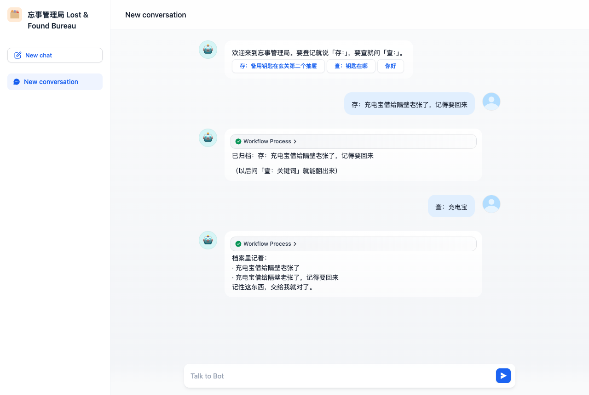

# 忘事管理局 · Lost & Found Bureau

> Dify 赛道（Just for Fun）｜`dify/`｜分支 `2026-competition-ecosystem`
> **不需要登录、不需要 API Key、不需要配模型** —— 起服务、导 DSL、打开链接就能玩。



## 0. 三步跑起来

```bash
# 1) 起 Dify + PowerContext + 记忆桥（一条命令）
cd <dify源码>/docker
docker compose -f docker-compose.yaml -f <本仓库>/dify/deploy/docker-compose.full.yaml up -d --build
```

```text
# 2) Dify 控制台(http://localhost) → 工作室 → 导入 LostFound.yml → 发布
# 3) 应用「概览 → 公开访问」拿到 /chat/<code> 链接，直接打开就能聊
```

无需选择模型：整个流程没有 LLM 节点，回答由代码节点根据检索结果生成。

## 1. 作品

一个帮你记事的小工具，语气是官僚机构式的：

```
存：充电宝借给隔壁老张了，记得要回来   →  已归档
查：充电宝                            →  档案里记着：· 充电宝借给隔壁老张了，记得要回来
你好                                  →  使用说明
```

记忆存在 **PowerContext** 里（持久化、跨会话、重启不丢），不是塞在对话上下文里。

## 2. 技术分工

| 技术 | 作用 |
|---|---|
| **Dify**（必选） | 编排：关键词分流（if-else）→ 调记忆桥（HTTP）→ 代码节点整理结果 → 回复 |
| **PowerContext**（二选一） | 记忆的持久化与检索：登记写 memory，查询按关键词召回 |

```
start → if-else
         ├─「查/找」 → HTTP /recall → 代码节点（解析档案 JSON）→ answer
         ├─「存：/登记」→ HTTP /remember → answer（回执）
         └─ 其他       → answer（使用说明）
```

8 个节点、7 条边；DSL 里两个 HTTP 节点用环境变量 `MEMORY_BRIDGE_URL`（默认 `http://memory-bridge:19080`）。

## 3. 版本与依赖

| 组件 | 版本 |
|---|---|
| Dify | 0.15.3（DSL 0.1.3 / advanced-chat；1.x 导入会升级 DSL 版本） |
| PowerContext | 1.4.1（容器，18080） |
| 记忆桥 | FastAPI + uvicorn（`backend/`，19080） |
| 模型 | 不需要 |

## 4. 验证

`bash deploy/verify_e2e.sh`（需 `DIFY_API_KEY`）或按 [`docs/验证样例.md`](docs/验证样例.md) 手动点。

实测记录：[`evidence/10-lostfound.log`](evidence/10-lostfound.log)。

## 5. 目录

```
dify/
├── LostFound.yml          # DSL（8 节点）
├── README.md
├── docs/验证样例.md        # 用例与截图
├── backend/               # 记忆桥（含 Dockerfile）
├── deploy/                # 全容器 compose、PowerContext 镜像、验证/诊断脚本
└── evidence/              # 实测日志
```

## 6. 限制

1. 检索是关键词/全文匹配，近义改写可能召不回；接 embedding 可提升。
2. 记忆桥无鉴权，只监听容器网络；生产需加 `PC_TOKEN`。
3. PowerContext 容器为演示开启了「允许非 loopback 无鉴权监听」，生产应改用鉴权。
