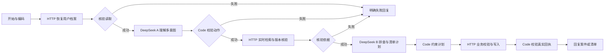

# 工作流与状态

## Dify 是核心编排

DSL 为 `advanced-chat`，19 个节点、18 条边。两个原生 LLM 节点直接列在 Dify 画布上；不是单个 HTTP 节点调用外置聊天代理。

公开聊天页关闭工作流步骤详情；管理员在 Dify 控制台查看执行信息。HTTP 使用专用 Bearer 认证字段，利用 Dify 的鉴权日志遮罩，内部服务凭据不应出现在步骤日志中。

## 每轮的后端契约

1. `/v2/turns/begin`：用 Dify `sys.user_id` 获取隔离 scope，从 PowerContext 分页读取事件并重放状态；返回服务端日期、待答问题、案件、清单及最近真实证据 ID。
2. 模型 A 提取白名单动作，Code 节点拒绝非法 JSON、未知动作和多余字段。允许复合句最多 8 个动作；不允许模型输出用户 ID 或控制 scope。
3. `/v2/context/resolve`：重新读取当前版本；如果另一对话已经更新则返回冲突。调用真实 `/v1/memory/search`，提供当前状态及真实证据，旧搜索命中不会覆盖新状态。
4. 模型 B 生成一个建议与追问、相关清单建议、引用 ID。Code 节点约束类型和长度；无效计划降级为空。后端拒绝不存在的证据引用，并过滤重复或无依据的具体地点。
5. `/v2/turns/commit`：对状态副本应用动作。借出物品不能直接完成装包；未明确找到不结案；未明确完成不打勾。任何业务歧义均整轮回滚。变更后向 PowerContext 写入一个有序事件，核对实际 `artifact.artifact_id` 后才返回成功。

事件格式为 `lostfound.event.v3`，保存顺序号、turn ID、时间、用户原话和变更 patch。单进程锁与旧版本检查防止并发覆盖；同一 turn 重试返回相同回执。遇到可能已写入的超时，重读真实事件确认，而非盲目追加。

## 领域状态

| 对象 | 关键状态 | 规则 |
|---|---|---|
| 物品 | 上次位置、常用位置、最近电量、借给谁、可用性 | 位置带记录时间；历史位置不等于当前位置；找到位置不自动成为常用位置 |
| 案件 | 调查中 / 已结案 / 已取消、排查地点、线索 | 简短回复依赖持久化待答问题；新会话有多个案件时追问对象 |
| 本次出门 | 活动、日期、事项与确认时间 | 取回、充电、装包分别记录；新行程全部重新确认 |
| 待答问题 | 问题类型、案件、会话、明确候选地点 | 跨会话保留；上下文不明确就追问，不能任意写入模型推荐地点 |

清单项目状态为 `pending / done / excluded`。明确“未装包”或“从包里拿出来”可从 done 回到 pending；本次排除不会清除物品的借出事实。物品重新登记位置、再次丢失或借出，会撤回已有装包确认。

不同日期同类活动可并存。“这次”默认最近一次；明确说明日期时按服务器日期筛选。任务时间按 Asia/Shanghai 计算，只用于清单展示，不会创建后台提醒。

## 持久化和边界

真实业务状态来自 PowerContext，不靠进程变量恢复；容器重建后仍分页重放。桥接数据卷保存用户 scope 映射，必须保留。本版未做多进程分布式锁、历史压缩、无限规模档案或跨设备登录。

`/health` 检查 PowerContext 可用性，`memories` 字段对应兼容旧版的共享 scope，并非新版全部用户的总量。新版验收通过自己的用户 scope 和节点回执核对数据，不用这个计数代替持久化证据。
